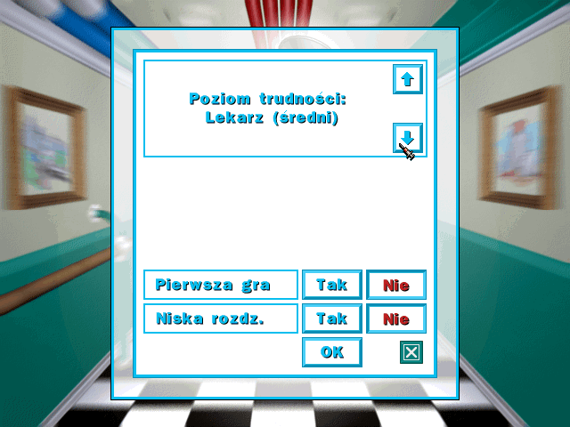
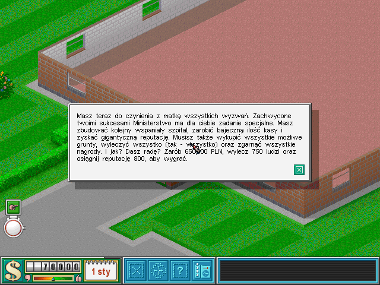

# Theme Hospital Steam PL

Nieoficjalne spolszczenie **Theme Hospital ze Steam**, działające z oryginalną grą uruchamianą przez DOSBox. Podstawą jest polskie tłumaczenie CorsixTH. Ta adaptacja dodaje instalator, polskie czcionki i poprawki potrzebne w wydaniu Steam.

**[Pobierz wersję 0.2 beta](https://github.com/hsr88/theme-hospital-steam-pl/releases/tag/v0.2-beta)**

Sprawdzona wersja gry: **Steam App ID 2229820, build 25682708**. Instalator wymaga własnej kopii gry i języka **English** ustawionego w Steam. Nie instaluje silnika CorsixTH.

## Instalacja

1. Pobierz `ThemeHospital-PL-0.2-beta-public.zip` z sekcji Releases i rozpakuj cały plik do osobnego folderu.
2. Zamknij Theme Hospital i DOSBox. W Steam pozostaw język gry **English**.
3. Uruchom `Sprawdz.cmd`. Narzędzie wyszuka grę i sprawdzi zgodność plików.
4. Uruchom `Instaluj.cmd` i wpisz `TAK`.
5. Uruchom grę zwykłym przyciskiem **Graj** w Steam.

Instalator najpierw tworzy i sprawdza kopie oryginalnych plików. Dopiero potem je podmienia. Backup znajduje się w folderze `.thpl/backup` w katalogu gry.

Jeśli masz już spolszczenie **0.1 beta**, zamiast `Instaluj.cmd` uruchom `Aktualizuj.cmd`. Zachowa ono także poprzednią wersję w `.thpl/history`.

Do instalacji wystarcza Windows PowerShell 5.1. Python jest potrzebny tylko do narzędzi dla osób rozwijających projekt. Nie uruchamiaj skryptów bezpośrednio z podglądu ZIP-a.

## Odinstalowanie

Zamknij grę i uruchom `Odinstaluj.cmd` z pakietu **0.2**. Po potwierdzeniu `TAK` narzędzie przywróci oryginały. Zapisy rozgrywki pozostaną bez zmian.

Nie usuwaj `.thpl` przed odinstalowaniem. Po przerwaniu instalacji użyj deinstalatora tej samej wersji. Jeżeli Steam zaktualizuje grę lub inny mod zmieni jej pliki, instalator może odmówić działania. Nie wymuszaj wtedy przywrócenia starego backupu.

## Zakres tłumaczenia

Spolszczenie obejmuje teksty całej kampanii: menu, komunikaty, odprawy, opisy chorób, pomieszczeń i wyposażenia. Obsługuje wyświetlanie wszystkich 18 polskich liter.

Wersja 0.2 zawiera 123 poprawione lub uzupełnione wpisy względem 0.1. Dodaje też polskie nazwy trudności: „Stażysta (łatwy)”, „Lekarz (średni)” i „Konsultant (trudny)”, oraz etykietę gry wieloosobowej. Usuwa 21 znaczników skrótów klawiszowych z CorsixTH, których oryginalne menu nie obsługuje.

Pakiet zmienia **93 pliki**: plik językowy, 88 plików czcionek oraz etykiety w czterech plikach ustawień poziomów. Zachowuje oryginalny EXE, DOSBox, launcher, mapy i parametry rozgrywki.

Głosy, filmy, napisy wrysowane w grafiki i zewnętrzny launcher pozostają w oryginale. Zachowano nazwiska autorów, nazwy własne oraz potrzebne identyfikatory techniczne. Wyświetlanie polskich liter nie oznacza obsługi ich wpisywania w nazwie zapisu.

## Co sprawdzono

Sprawdzono instalację, aktualizację, odinstalowanie i przywracanie po błędzie, strukturę wszystkich 2610 wpisów oraz ładowanie szpitali 1–12 z polskimi odprawami. Potwierdzono też uruchamianie przez Steam. Szczegóły są w [opisie testów](docs/TESTY.md).

To **wersja beta**. Nie przetestowano pełnego przejścia kampanii, każdego okna, wszystkich rozdzielczości ani gry wieloosobowej. Część sformułowań może wymagać korekty.

Zauważony błąd zgłoś w [Issues](https://github.com/hsr88/theme-hospital-steam-pl/issues). Podaj wersję gry i patcha, ekran lub poziom oraz treść błędu. Zrzut ekranu ułatwi poprawkę. Usuń z niego dane, których nie chcesz udostępniać.

## Autorzy i licencje

Tłumaczenie źródłowe przygotowali **Bemberg, BuTcHeR, Johnny, Machiner, mziab, spec0071 i twig**, związani z eXtragry.pl i GrajPoPolsku. Wykorzystano plik [`polish.lua` z CorsixTH](https://github.com/CorsixTH/CorsixTH/blob/55989c8ccd760e863ea35df831f5a8621b39c638/CorsixTH/Lua/languages/polish.lua), udostępniony na licencji MIT.

Adaptacja do Steam, dodatkowe teksty, narzędzia i testy powstały z pomocą **OpenAI Codex**. Wydanie publikuje i utrzymuje **hsr88**. To adaptacja istniejącego tłumaczenia z uzupełnieniami, a nie tłumaczenie wykonane od zera.

Pełne informacje znajdują się w [AUTHORS.md](AUTHORS.md), [LICENCJE.txt](LICENCJE.txt) i [LICENSES](LICENSES). Licencja projektu nie obejmuje samej gry ani jej oryginalnych zasobów. Patch buduje zmienione pliki lokalnie z danych użytkownika; w repozytorium nie ma oryginalnego EXE, kompletnych fontów, map, filmów ani zapisów gry.

Projekt nie jest oficjalnym produktem EA, Bullfrog, Valve ani zespołu CorsixTH.

## Pliki projektu

- `Spolszczenie.ps1` i pliki `.cmd`: instalacja, kontrola zgodności i odinstalowanie.
- `Aktualizuj.ps1` oraz `aktualizacja-z-0.1`: aktualizacja poprzedniego wydania.
- `patch.json`: polskie zamienniki, operacje nakładania różnic i sumy kontrolne.
- `src`: źródła narzędzia RNC, wykorzystane pliki CorsixTH i dodatkowe teksty.
- `tools`: kontrola integralności i tworzenie paczki z jawnej listy plików.
- `docs/STEAM.txt`: gotowy opis do poradnika Steam, w formacie BBCode.

Opis formatu i pracy ze źródłami: [TECHNICZNIE.md](docs/TECHNICZNIE.md).
